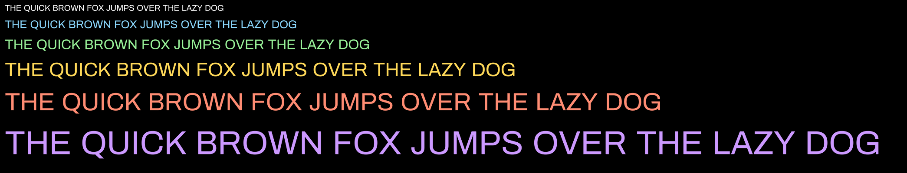

# font_renderer

A GPU text renderer in C based on the Slug algorithm (Eric Lengyel,
*GPU-Centered Font Rendering Directly from Glyph Outlines*, JCGT 2017).

Glyphs are drawn straight from their outlines. There is no bitmap atlas and no
signed distance field. The fragment shader works out how much of each pixel the
glyph's quadratic Bézier curves cover. That keeps text sharp and anti-aliased at
any size from one copy of the glyph data.



*12, 16, 20, 28, 36 and 48 px from the same glyph outlines (Archivo Regular,
display scale 1.6).*

The window layer, OpenGL loader setup, math and containers are written for the
project. The only third-party code is `stb_truetype`, `glad` and the
`xkbcommon` headers.

## Status

**2D text rendering is complete and ready for others to use.** The text code
lives in `src/text/` and the two shaders in `assets/shaders/`, and it can be
taken as-is for screen-space text. It covers:

- Glyph outlines load from a TrueType font (ASCII `' '`..`'~'`) and are stored
  as quadratic curves in em units.
- Coverage is computed per pixel with signed winding, so holes (`O`, `B`, `8`,
  `@`) and multiple contours render correctly.
- Horizontal and vertical rays are combined, each weighted by how close its
  nearest crossing is to the pixel.
- Each glyph's curves are split into 8 horizontal and 8 vertical bands, so a
  pixel only tests the curves near it.
- Layout covers advances, line height, `\n`, `\t` and wrapping at a given width.
- All glyphs in a frame are drawn with one instanced draw call.
- Logical units are scaled to physical pixels, so text stays crisp on HiDPI
  and fractionally scaled displays.

Known limitations: no kerning, non-ASCII text (shown as `?`), CFF/`.otf` fonts
(cubic curves), more than one font, and text in a 3D scene.

In progress, outside the text code: renderer batching, so text and UI shapes
can be drawn interleaved in push order.

## Requirements

- Linux with Wayland (an X11 path exists in `build.sh` and the platform layer)
  or Windows
- A GPU and driver with OpenGL 4.3 (the shaders use SSBOs)
- `clang` (or another C compiler via `CC=...`)
- Linux only: `pkg-config` and the development packages for `egl`, `gl`,
  `wayland-client`, `wayland-egl` and `xkbcommon`. `build.sh` names the
  packages for Arch, Fedora and Ubuntu/Debian if any are missing.

## Build and run

Linux:

```sh
./build.sh            # picks Wayland or X11 from $XDG_SESSION_TYPE
./build.sh wayland    # or choose explicitly

cd bin && ./slug
```

Windows:

```bat
build.bat
cd bin && slug.exe
```

Run the binary from `bin/`: shaders and the font are loaded from `../assets`.
Press `Escape` to quit.

## How it works

1. **Load** (`src/text/text.c`). `stb_truetype` returns each glyph's outline as
   move / line / curve commands. Lines become quadratic curves with the control
   point at the midpoint, so the GPU only handles one curve type. Everything is
   converted from font units to em once.
2. **Prepare.** For each glyph: compute a tight bounding box (endpoints plus
   curve extrema), split it into bands on each axis, and list the curves that
   overlap each band.
3. **Upload** (`src/text/text_gl.c`). All curves go into one SSBO, and the band
   lists into two more. This happens once, at load time.
4. **Per frame.** `text_push_string` lays out a string and appends one
   `glyph_instance` per visible glyph: pen position, curve range, color and
   size, the glyph's box, and its band ranges. One instanced draw renders all of
   them.
5. **Vertex shader.** Places a quad over the glyph's box and grows it by half a
   pixel, so edge pixels get shaded.
6. **Fragment shader** (`assets/shaders/text_fragment.glsl`). Casts a horizontal
   and a vertical ray from the pixel against the curves in its band. A 16-bit
   lookup table, based only on which control points lie above the ray, decides
   which roots count. That avoids the usual precision problems where curves
   meet. Each crossing adds a partial amount based on its distance from the
   pixel center, and the two rays are blended into the final alpha.

## Layout

```text
src/core/       entry point, math (db_math.h), containers and arenas (db.h), input
src/platform/   Wayland / X11 / Win32 windows and GL contexts
src/renderer/   renderer front end and thin OpenGL wrappers (VAO, VBO, SSBO, shader)
src/text/       font loading, banding, layout, text GPU state
assets/         shaders and the font
vendor/         stb_truetype, glad, xkbcommon headers
```

`AGENTS.md` holds the project conventions and roadmap. `progress.md` holds
working notes on the current state.

## Credits

- Algorithm: Eric Lengyel, "GPU-Centered Font Rendering Directly from Glyph
  Outlines", *Journal of Computer Graphics Techniques*, vol. 6, no. 2, 2017.
- [stb_truetype](https://github.com/nothings/stb) by Sean Barrett.
- [glad](https://github.com/Dav1dde/glad) OpenGL loader.
- Font: Archivo by Omnibus-Type, under the SIL Open Font License.

## License

This project's own code is released into the public domain under the
[Unlicense](LICENSE). You can use it for anything, with no conditions.

If you use it, I'd appreciate a line in your credits, for example:

> Text rendering based on [font_renderer](https://github.com/GalacticPast/font_renderer) by GalacticPast.

That's a request, not a requirement.

Third-party files keep their own licenses and are not covered by the
Unlicense:

- `vendor/`: stb_truetype, glad and the xkbcommon headers
- `src/platform/wayland/`: files generated from Wayland protocol definitions
  (MIT, copyright their respective authors)
- `assets/font/`: Archivo, under the SIL Open Font License

## AI use disclosure

All code in this repository was written by me, except the fragment shader
(`assets/shaders/text_fragment.glsl`), which was written with help from an AI
assistant, Claude (Anthropic), through Claude Code. I plan to rewrite the
fragment shader myself; this section will be updated when that is done.

Other AI use:

- **Mentoring and code review.** Claude was used as an engineering mentor,
  following the rules in `AGENTS.md`. It explained the Slug algorithm and
  renderer architecture (batching, instance layouts, draw ordering) and
  reviewed my code for bugs, which I then fixed myself.
- **Documentation.** `README.md` and `progress.md` were drafted by AI from the
  code and our discussions, then reviewed by me.
- **Repository.** One merge commit was completed by AI and is marked with a
  `Co-Authored-By` trailer.
